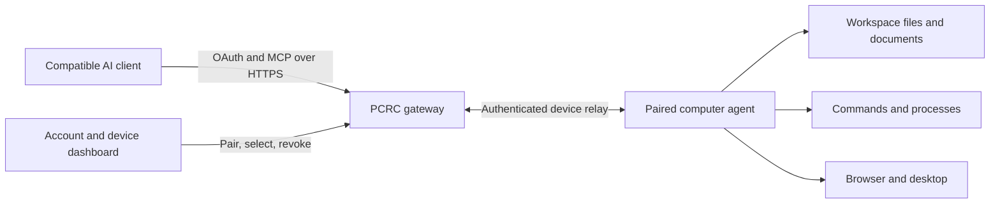

<p align="center">
  
</p>

<h1 align="center">PC Remote Commander (PCRC)</h1>

<p align="center"><strong>Connect your AI to your computer. Control, automate, and get things done.</strong></p>

PCRC lets a compatible AI assistant work with files, commands, an isolated browser, and desktop apps on a computer you approve. Use it to check a local project, update a document, or run a test without copying every result back into chat.

[](https://github.com/pcremotecommander-code/pcremotecommander/releases/tag/v0.7.0-beta.48)
[](https://www.npmjs.com/package/pcremotecommander)
[](https://www.npmjs.com/package/pcremotecommander)
[](https://github.com/pcremotecommander-code/pcremotecommander/actions/workflows/source-checks.yml?query=branch%3Anext)
[](https://github.com/pcremotecommander-code/pcremotecommander/issues)

[Website](https://pc-remote-commander.pcremotecommander.workers.dev/) · [Dashboard](https://pc-remote-commander.pcremotecommander.workers.dev/devices) · [Setup](#quick-start) · [Tools](#available-tools) · [Troubleshooting](#troubleshooting) · [Support PCRC](#support-pcrc--buy-me-a-coffee) · [Beta.48 release notes](https://github.com/pcremotecommander-code/pcremotecommander/releases/tag/v0.7.0-beta.48)

> **[New in 0.7.0-beta.48](https://github.com/pcremotecommander-code/pcremotecommander/releases/tag/v0.7.0-beta.48)** · Transfer files directly over a trusted local network between two online computers enrolled in the same PCRC account. The receiver accepts up to 120 MB by default. The prerelease includes npm setup and file-transfer commands. [File-transfer source on next](https://github.com/pcremotecommander-code/pcremotecommander/tree/next).

> **Community update** · [An apology and an update on recent service interruptions](ANNOUNCEMENT.md).

## Quick start

1. On the Windows PC you want to connect, [download Start-PCRC.cmd](https://pc-remote-commander.pcremotecommander.workers.dev/install/Start-PCRC-beta48.cmd) and double-click it. If you already have Node.js 20+ and npm, run:

   ```cmd
   npx --yes pcremotecommander@beta setup
   ```

2. Sign in to PCRC. Compare the terminal and browser pairing codes, review the requested access, and approve the request you started. Select the computer for AI tools in the dashboard.
3. Leave the terminal open at **Ready to work**. [Connect your assistant](#connect-an-ai-assistant) using the same PCRC account.
4. Ask your assistant: “Use PCRC to check the connected computer and its capabilities.” Try reading a disposable test file before approving a write.
5. To disconnect the device, press **Ctrl+C** in the PCRC terminal. Run the same launcher to reconnect. Use **Revoke** in the dashboard when you want to remove its pairing.

The first run downloads a checksum-verified runtime under your account. Later runs reuse the installed version. See the [full setup guide](docs/install.md) for alternatives and detailed pairing instructions.

## Connect an AI assistant

Use the remote MCP endpoint and OAuth:

```text
https://pc-remote-commander.pcremotecommander.workers.dev/mcp
```

| Client | Where to connect |
| --- | --- |
| ChatGPT | Add a custom MCP server in Apps or Connectors, then enable the connection in your chat. [ChatGPT setup](docs/install.md#chatgpt) |
| Claude | Open **Connectors → Add custom connector**, enter the endpoint, and enable it in a conversation. [Claude setup](docs/install.md#claude-web-or-claude-desktop--remote-connector) |
| Cursor | Add the endpoint to your MCP settings and authorize it before enabling it for Agent. [Cursor setup](docs/install.md#cursor--remote-mcp) |

Your client plan and workspace must allow custom remote MCP connections. Menu labels can vary. These are configuration guides. Check your device and capabilities in the client you intend to use. PCRC supplies computer access, while your AI assistant supplies the model. PCRC is distributed as a custom connector.

## Available tools

| What you want to do | Examples |
| --- | --- |
| Find or edit files | Search one project, read matching files, preview a change, and verify it after saving. |
| Work with documents and media | Inspect a spreadsheet, create or reorder a PDF, resize a test image, or transcribe a short clip with the optional offline model. |
| Run commands and manage processes | Ask for a Python version check, run a project test, read its output, or stop a process PCRC started. |
| Set up a Python project | Review a plan for a separate environment. Packages are installed per environment. |
| Use an isolated browser | Open a test page, inspect it, and record or replay a reviewed workflow. |
| Use the desktop | Inspect accessible controls or review a fresh screenshot before clicking, typing, or sending a shortcut. |
| Coordinate assistants | Assign separate file areas and hand off work. Participating tools reject conflicting writes. |
| Manage access | Check the selected computer and connection capability, review approvals, or revoke a device in the dashboard. |

[80-tool catalog and beta.45 changes](docs/beta45-keyboard-release.md#tool-by-tool-reference) · [Local CLI and workflow skills](docs/skills.md)

## How it works



The gateway routes an authorized request to your selected computer. The local agent checks permissions and runs supported operations. Your assistant receives the result so it can help you verify what happened.

## Security and compatibility

- Compare both pairing codes. Approve capabilities and actions you expect. Revoke access in the dashboard when you no longer need it.
- Commands run with your operating-system account's privileges and can reach beyond the file workspace. Screenshots and tool results can contain private information and pass through the service and your AI provider. HTTPS and WSS protect transport.
- Windows 10/11 is the primary beta setup. The `npx` launcher needs Node.js 20+ and npm. `Start-PCRC.cmd` can prepare missing prerequisites. Hosted use requires internet and the agent terminal to stay open.
- Linux and macOS beta installers are available from the dashboard. Artifact checksums were verified. Fresh native acceptance across those platforms is pending. Desktop support depends on OS permissions and the session type.
- The default branch contains guides and launcher information. The [source and test branch](https://github.com/pcremotecommander-code/pcremotecommander/tree/next) contains the runtime development baseline. The hosted service operates separately.

[Security notes](docs/security.md) · [Privacy](https://pc-remote-commander.pcremotecommander.workers.dev/privacy/) · [Terms](https://pc-remote-commander.pcremotecommander.workers.dev/terms/) · [Refund policy](https://pc-remote-commander.pcremotecommander.workers.dev/refunds/)

## Troubleshooting

| What you see | What to check |
| --- | --- |
| Device offline | Start PCRC on the intended computer and confirm it is selected in the dashboard. Keep the terminal open. |
| `UNAUTHORIZED` | Reauthorize the PCRC connector in your AI app using the account that owns the device. Keep the PC launcher running. |
| `Unknown tool` | Refresh tool discovery in your client or check in a fresh chat. If it persists, report the tool name, agent version, and error. |
| Command or edit denied | Check the device capability, client OAuth scope, approval, workspace path, or task reservation. Inspect current state before retrying an uncertain action. |
| Typing reports dispatch only | Check a fresh screenshot or accessible control before proceeding. Some apps handle simulated input differently. |
| Usage or quota limit | Open the dashboard to check usage and the website for current plan limits. PCRC offers a free plan. AI client subscriptions are separate. |

## Roadmap and support

- **Available now:** Windows beta pairing and remote tools, workspace safeguards, and reviewed task handoffs.
- **In development:** simpler connection recovery and broader published tool and platform testing.
- **Planned:** explore hybrid multi-cloud architecture. The current diagram shows the deployed flow.

Report bugs or suggest features in [GitHub Issues](https://github.com/pcremotecommander-code/pcremotecommander/issues). Include your version, platform, and steps using synthetic examples. Keep credentials, authorization links, and private content out of public reports. For security concerns, follow the [security reporting guide](docs/security.md). You can also reach [PCRC support](mailto:pcremotecommander@gmail.com).

## Support PCRC — Buy Me a Coffee

Hi, I'm the solo developer behind PCRC. I build and maintain it independently, and I appreciate everyone who uses it, reports a bug, or shares an idea.

If you'd like to contribute, any amount you choose helps, even $1. Contributions help cover:

- 🌐 Infrastructure and hosting expenses
- 🛠️ Development and testing tools
- 🐛 Bug fixes and reliability improvements
- 🌱 Future PCRC development

Donations are completely optional. You can use PCRC's free personal and local features without donating. Thanks for being part of the PCRC community.

<a href="https://buymeacoffee.com/pcremotecommander">
  
</a>
