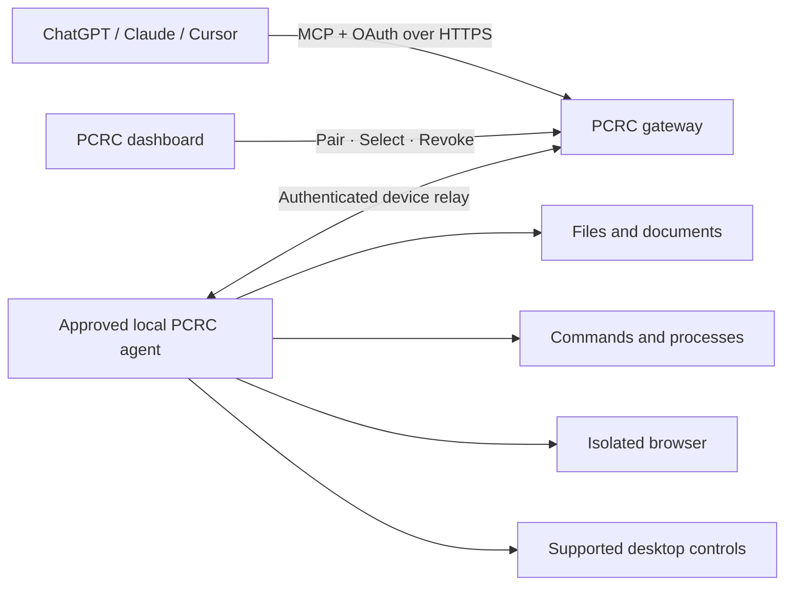

<p align="center">
  
</p>

<h1 align="center">PC Remote Commander (PCRC)</h1>

<p align="center"><strong>Connect your AI assistant to the computer you approve.</strong></p>
<p align="center">A permission-based computer access layer for compatible AI clients — files, terminal, isolated browser and desktop workflows through MCP.</p>

<p align="center">
  <a href="https://www.npmjs.com/package/pcremotecommander"></a>
  <a href="https://img.shields.io/npm/dw/pcremotecommander"></a>
  <a href="https://github.com/pcremotecommander-code/pcremotecommander/actions/workflows/source-checks.yml"></a>
  <a href="https://github.com/pcremotecommander-code/pcremotecommander/issues"></a>
  <a href="https://github.com/pcremotecommander-code/pcremotecommander"></a>
</p>

<p align="center">
  <a href="https://pc-remote-commander.pcremotecommander.workers.dev/">Website</a> ·
  <a href="https://pc-remote-commander.pcremotecommander.workers.dev/devices">Dashboard</a> ·
  <a href="https://github.com/pcremotecommander-code/pcremotecommander/blob/main/docs/install.md">Installation guide</a> ·
  <a href="https://github.com/pcremotecommander-code/pcremotecommander/issues">Support</a>
</p>

> **Current public npm beta: 0.7.0-beta.49.** The beta channel is updated independently from the GitHub default `latest` tag. Use `@beta` for the PCRC beta installer.

## What is PCRC?

PC Remote Commander connects a compatible AI assistant to a computer that you pair and approve. Your AI client provides the reasoning; PCRC provides the controlled connection to local computer capabilities.

Use PCRC to inspect a project, read or edit approved files, run commands, interact with an isolated browser, or perform supported desktop actions — without manually moving every result between your computer and chat.

**PCRC is not an AI model host.** Your AI provider, account, subscription and client permissions remain separate.

## Quick start

On the computer you want to connect, install Node.js 20+ and run:

```powershell
npx --yes pcremotecommander@beta setup
```

Or use the short alias:

```powershell
npx --yes pcrc@beta setup
```

1. Sign in to your PCRC account when the pairing page opens.
2. Compare the code shown in the terminal with the code in the browser.
3. Review the computer name and requested permissions. Approve only the request you started.
4. Select the connected computer in the [PCRC dashboard](https://pc-remote-commander.pcremotecommander.workers.dev/devices).
5. Keep the terminal open while using PCRC. Press `Ctrl+C` to disconnect.

The first setup downloads and verifies the runtime. Later runs reuse the installed version. See the [full installation guide](https://github.com/pcremotecommander-code/pcremotecommander/blob/main/docs/install.md).

## Connect your AI client

PCRC exposes a remote MCP endpoint. Add it as a custom connector and choose OAuth:

```text
https://pc-remote-commander.pcremotecommander.workers.dev/mcp
```

| Client | Setup |
| --- | --- |
| ChatGPT | [Custom MCP setup](https://github.com/pcremotecommander-code/pcremotecommander/blob/main/docs/install.md#chatgpt) |
| Claude | [Remote connector setup](https://github.com/pcremotecommander-code/pcremotecommander/blob/main/docs/install.md#claude-web-or-claude-desktop--remote-connector) |
| Cursor | [MCP setup](https://github.com/pcremotecommander-code/pcremotecommander/blob/main/docs/install.md#cursor--remote-mcp) |

Your AI client and workspace must support custom MCP connections. PCRC does not bypass provider subscription or workspace restrictions.

## What you can do

| Capability | Example |
| --- | --- |
| **Files and documents** | Search a project, inspect files, preview changes and verify saved results. |
| **Terminal and processes** | Check environments, run project tests and inspect command output. |
| **Isolated browser** | Open test pages, inspect content and automate supported browser actions in a separate context. |
| **Desktop control** | Inspect supported UI elements and perform reviewed clicks, typing and shortcuts. |
| **Task coordination** | Assign separate resources to participating AI assistants and coordinate explicit handoffs. |
| **Device management** | Pair computers, select the active device, inspect connection status and revoke access. |

Availability depends on the installed agent version, platform, local capability approvals and AI client OAuth scopes. A tool appearing in the catalog does not mean every operation is enabled on every device.

## How it works



The gateway routes authorized requests to the selected computer. The local agent checks device capabilities and action permissions before performing supported operations. The assistant receives the result and can help verify it.

## Security model and safe use

- Connect only computers and data you own or are authorized to access.
- Compare pairing codes and review device capabilities and OAuth scopes before granting control.
- Commands run with the privileges of your operating-system account; do not assume they are restricted to one project directory.
- Browser automation uses an isolated context and should not reuse your everyday browser profile or cookies.
- Screenshots and tool results may contain private information and pass through the PCRC service and your AI provider. HTTPS/WSS protect transport; they do not make content invisible to those services.
- Use a disposable workspace for beta testing and maintain your own backups.
- Revoke a paired device in the dashboard when access is no longer needed.

Read the [security notes](https://github.com/pcremotecommander-code/pcremotecommander/blob/main/docs/security.md), [privacy policy](https://pc-remote-commander.pcremotecommander.workers.dev/privacy/) and [terms](https://pc-remote-commander.pcremotecommander.workers.dev/terms/).

## Platform and beta status

- **Windows:** primary beta setup and current acceptance focus.
- **Linux/macOS:** beta installer paths exist; clean native platform acceptance remains a separate verification requirement.
- **Browser and desktop:** require supported local runtime components and explicit device capabilities.
- **Service:** hosted gateway availability and quotas are separate from local-only development and testing.

PCRC is beta software and has not completed an independent production security certification. Features, limits and compatibility can change. Review the current release notes and test the exact version you install.

## Repository structure

| Path | Purpose |
| --- | --- |
| `src/jan_mcp_commander/` | Local agent and computer-control implementation. |
| `deploy/mcp-task-server/` | MCP tool catalog, schemas and task coordination server. |
| `deploy/cloudflare/worker/` | Gateway, OAuth, dashboard and service routes. |
| `deploy/npm/launcher/` | Public npm launcher and platform setup. |
| `scripts/` | Build, packaging and release validation. |
| `tests/` | Regression and acceptance tests. |
| `docs/` | Installation, security, development and release documentation. |

The repository uses `main` for accepted public documentation/release work and `next` for the runtime development baseline and upcoming verification batches. See the [release process](https://github.com/pcremotecommander-code/pcremotecommander/blob/next/docs/release-process.md).

## Roadmap

- Improve browser reliability and cross-platform acceptance.
- Strengthen packaged-release verification and installation recovery.
- Continue expanding safe, permission-aware computer workflows.
- Explore a **Hybrid Multi-Cloud Architecture** for resilience and service continuity.

## Support the project

PCRC is developed independently. If the project is useful to you, you can support ongoing infrastructure, testing and development. Contributions are optional; local personal use does not depend on donating.

<a href="https://buymeacoffee.com/pcremotecommander">
  
</a>

## Contributing and support

- [Report a bug](https://github.com/pcremotecommander-code/pcremotecommander/issues/new)
- [Request a feature](https://github.com/pcremotecommander-code/pcremotecommander/issues)
- [Review the security guidance](https://github.com/pcremotecommander-code/pcremotecommander/blob/main/docs/security.md)

Please use synthetic examples in public issues. Never post pairing links, tokens, passwords, private files or personal computer screenshots.

---

<p align="center"><strong>PC Remote Commander · Your computer, your approval, your AI workflow.</strong></p>

See [LICENSE.txt](LICENSE.txt) for the proprietary software license. Third-party components retain their own licenses.
